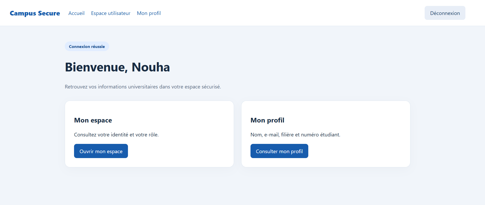
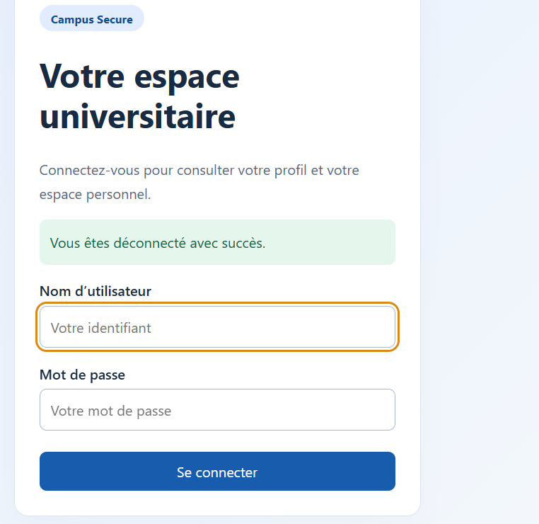
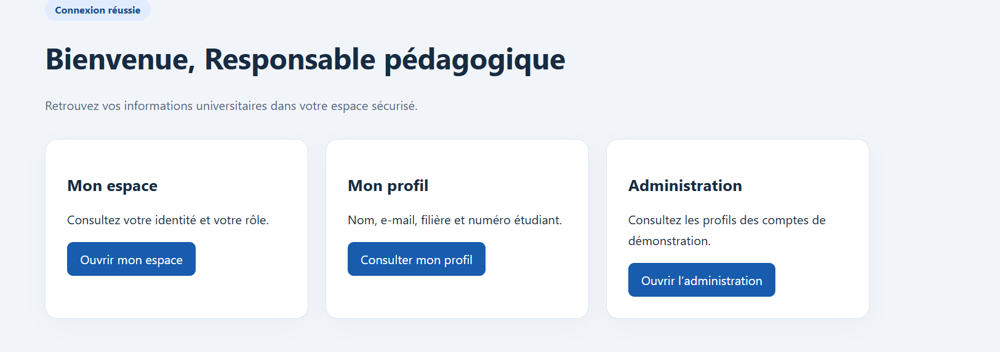

# Campus Secure — TP Spring Security

Application universitaire avec authentification en mémoire, formulaire de connexion personnalisé et autorisation selon les rôles, réalisée avec Spring Boot, Spring Security et Thymeleaf.

## Fonctionnalités

- Connexion via `POST /authenticate`, redirection vers `/home` et messages de connexion incorrecte ou de déconnexion.
- Espace utilisateur accessible aux rôles `USER` et `ADMIN`.
- Espace administrateur réservé au rôle `ADMIN`, avec tableau des profils.
- Profil personnel enrichi : nom, adresse e-mail, filière et numéro étudiant / matricule.
- Navigation adaptée au rôle et page d’accès refusé avec statut HTTP 403.
- Interface responsive, mots de passe encodés avec BCrypt et protection CSRF conservée.

Les profils sont fictifs, consultables uniquement et définis dans `AuthController.java`. Il n’y a ni base de données, ni inscription, ni modification de profil. Les champs ajoutés sont affichés dans le profil et le tableau administrateur ; l’authentification utilise le nom d’utilisateur et le mot de passe.

## Prérequis

- JDK 17 ou 21 ; configurer le même JDK dans l’IDE et dans `JAVA_HOME`.
- Maven 3.6.3 ou supérieur, installé et accessible dans le terminal.
- Un navigateur et le port 8080 disponible.

Le projet ne contient pas de Maven Wrapper : les commandes utilisent `mvn`.

## Organisation

```text
src/main/
├── java/ma/fstg/security/
│   ├── SecurityApplication.java
│   ├── config/SecurityConfig.java
│   ├── model/StudentProfile.java
│   └── web/AuthController.java
└── resources/
    ├── application.properties
    ├── static/css/style.css
    └── templates/
        ├── fragments.html
        ├── login.html
        ├── home.html
        ├── user-dashboard.html
        ├── admin-dashboard.html
        ├── profile.html
        └── access-denied.html
```

## Comptes de démonstration

| Identifiant | Mot de passe | Rôle |
| --- | --- | --- |
| `admin` | `1234` | `ADMIN` |
| `user` | `1111` | `USER` |

Ces identifiants sont destinés uniquement au TP local.

## Flux d’authentification

1. Une requête vers une page protégée traverse la `SecurityFilterChain`.
2. Sans session authentifiée, le navigateur est redirigé vers `/login`.
3. Le formulaire envoie les identifiants à `/authenticate`. Thymeleaf ajoute le jeton CSRF aux formulaires POST utilisant `th:action`.
4. Spring Security vérifie les identifiants dans le `InMemoryUserDetailsManager` avec BCrypt et établit le contexte de sécurité associé à la session.
5. En cas de succès, le navigateur arrive sur `/home` ; en cas d’échec, sur `/login?error=true`.
6. Un accès interdit à un utilisateur connecté affiche la page 403.
7. Le formulaire `POST /logout` termine la session puis redirige vers `/login?logout=true`.

Les liens visibles dépendent du rôle, mais les restrictions sont aussi appliquées côté serveur par `SecurityConfig`.

## Tester avant le dépôt sur GitHub

Les commandes suivantes sont à exécuter vous-même, depuis la racine du projet. Aucune compilation, application ou suite de tests n’a été exécutée lors de la préparation. Le projet ne contient pas de tests automatisés ; une compilation réussie ne valide donc pas les scénarios fonctionnels ci-dessous.

### 1. Vérifier les outils et compiler

```powershell
java -version
mvn -version
mvn clean package
```

Vérifier que Maven utilise le bon JDK et termine avec `BUILD SUCCESS`. Le premier build nécessite un accès Internet pour télécharger les dépendances.

### 2. Démarrer l’application

```powershell
mvn spring-boot:run
```

Ouvrir `http://localhost:8080/login`. Garder le terminal ouvert ; `Ctrl+C` arrête le serveur.

### 3. Vérifier les comportements

Utiliser une fenêtre privée pour commencer sans session. Pour contrôler les statuts HTTP, ouvrir les outils de développement du navigateur, onglet Réseau, avant la navigation.

| Action | Résultat attendu |
| --- | --- |
| Sans connexion, ouvrir `/user/dashboard` | Redirection vers `/login` |
| Sans connexion, ouvrir `/admin/dashboard` | Redirection vers `/login` |
| Se connecter avec `user` et un mauvais mot de passe | Retour sur `/login?error=true` avec message d’erreur |
| Se connecter avec `user` / `1111` | Redirection vers `/home`, nom du profil visible |
| Avec `user`, ouvrir `/user/dashboard` | Page accessible, rôle `USER` affiché |
| Avec `user`, ouvrir `/user/profile` | Nom, e-mail, filière et numéro étudiant visibles |
| Avec `user`, saisir directement `/admin/dashboard` dans l’URL | Page « Accès refusé », statut 403 ; aucun tableau de profils |
| Cliquer sur « Déconnexion » | Retour sur `/login?logout=true` avec confirmation |
| Après déconnexion, saisir de nouveau `/user/profile` | Redirection vers `/login` |
| Se connecter avec `admin` / `1234` | Accueil avec lien Administration |
| Avec `admin`, ouvrir `/admin/dashboard` | Tableau des deux profils accessible |
| Avec `admin`, ouvrir `/user/dashboard` et `/user/profile` | Pages accessibles, profil administrateur affiché |
| Réduire la largeur du navigateur | Formulaires et navigation utilisables ; tableau défilable horizontalement |

Pour vérifier CSRF : sur la page de connexion, supprimer temporairement le champ caché `_csrf` du formulaire avec l’inspecteur du navigateur, puis soumettre. La requête doit être refusée avec un statut 403. Recharger la page pour récupérer un formulaire valide.

### 4. Vérifier le JAR

Arrêter d’abord le serveur avec `Ctrl+C`, puis lancer le JAR produit par la compilation :

```powershell
java -jar target/tp10lab3jee-1.0-SNAPSHOT.jar
```

Vérifier à nouveau la connexion et la déconnexion. Si le port 8080 est occupé, arrêter l’autre instance ou démarrer avec `--server.port=8081` et adapter l’URL du navigateur.

### 5. Préparer le dépôt

- Remplacer les profils fictifs dans `AuthController.java` si nécessaire, puis refaire les vérifications après modification.
- Ajouter les captures dans `docs/screenshots/`, puis remplacer les chemins réservés en fin de README par les noms de vos images.
- Vérifier qu’aucun mot de passe personnel, jeton ou fichier confidentiel n’est présent.
- Ne pas ajouter `target/` ni les fichiers de configuration de l’IDE.

Créer un dépôt GitHub vide, puis exécuter les commandes suivantes. Remplacer `VOTRE_COMPTE` par votre identifiant GitHub. Si le dossier est déjà un dépôt Git, ignorer `git init` ; si `origin` existe déjà, vérifier son URL avec `git remote -v` avant de l’adapter.

```powershell
git init
git add .
git status
git diff --cached
```

Relire les fichiers préparés, puis publier :

```powershell
git commit -m "Réaliser le TP Spring Security avec profils universitaires"
git branch -M main
git remote add origin https://github.com/VOTRE_COMPTE/tp10lab3jee.git
git push -u origin main
```

## Captures d’écran



